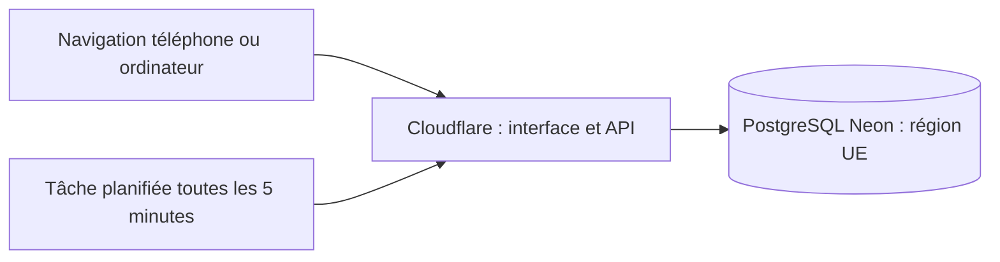

# Padel League La Cure — Spécifications techniques

Statut : architecture retenue pour la première version, à valider par un déploiement de démonstration avant ouverture aux joueurs. Ce document complète [les spécifications fonctionnelles](SPECIFICATIONS.md), qui font référence pour les règles de compétition.

## 1. Objectifs et contraintes

- Application web responsive en français, utilisable sur téléphone et ordinateur.
- Première compétition : 66 paires dans 11 box, du 12 octobre au 29 novembre 2026, heure belge.
- Hébergement, adresse HTTPS et stockage sur des offres gratuites **sans carte bancaire**.
- Pas de dépendance à un essai temporaire payant ; pas d'activation automatique d'une offre payante.
- Base de données en Union européenne si cette région est accessible sur l'offre gratuite.
- Accès des joueurs par lien personnel ; accès organisateur par mot de passe sans e-mail obligatoire.
- Confirmation automatique après 48 heures, indépendante des visites des joueurs.
- Préparation des cycles suivants sans effacer les résultats du premier cycle.
- Pas de réservation SportFinder, paiement, notification, coordonnées ou gestion complète des inscriptions dans la première version.

Les services ci-dessous proposent des offres gratuites connues, mais leurs conditions actuelles n'ont pas pu être vérifiées depuis l'environnement de rédaction : leurs pages officielles étaient bloquées par le proxy. **La gratuité sans carte, les quotas, la tâche planifiée et la région européenne doivent être vérifiés à l'inscription.** Aucun compte ni déploiement n'a encore été créé.

## 2. Architecture retenue

| Composant | Technologie | Responsabilité |
| --- | --- | --- |
| Interface | React, TypeScript, Vite | Écrans joueurs et organisateur, formulaires et navigation |
| API | Hono sur Cloudflare Workers | Sessions, autorisations, matchs, validation et classement |
| Fichiers statiques | Workers Static Assets | Distribution de l'interface sur la même adresse que l'API |
| Stockage | PostgreSQL sur Neon | Données métier, sessions et historique |
| Accès SQL | Requêtes SQL paramétrées et pilote Neon compatible Workers | Migrations SQL explicites et transactions avec verrous |
| Automatisation | Cloudflare Cron Trigger et Workers KV | Repères d’échéance et validation sans réveiller PostgreSQL inutilement |
| Validation des entrées | Zod | Contrats partagés et contrôles côté serveur |
| Tests | Vitest et Playwright | Règles métier, API et parcours sur navigateur |

Le choix d'un Worker évite l'entretien d'un serveur permanent. PostgreSQL permet d'exporter les données et de changer d'hébergeur. Les versions stables compatibles seront épinglées dans les dépendances et un fichier de verrouillage pendant l'implémentation.

### Flux



L'interface et l'API utilisent la même origine HTTPS. Les réponses privées de l'API ne sont pas mises en cache publiquement. La navigation directe vers un écran de l'application doit fonctionner grâce au routage de l'application web.

La localisation européenne de la base ne garantit pas une exécution exclusivement européenne : Cloudflare distribue les traitements sur son réseau mondial. Ne pas présenter l'architecture comme intégralement hébergée dans l'UE.

## 3. Organisation du dépôt et développement local

Structure proposée :

```text
src/
  web/                  Interface React
  server/               API Hono, sessions, autorisations, tâche planifiée
  shared/               Contrats et schémas de validation
  domain/               Points, classement et transitions métier
db/
  migrations/           Migrations SQL versionnées
  seed/                 Données initiales vérifiées, sans liens ni secrets
scripts/                Import, export et tâches d'exploitation
tests/                  Tests métier, API et parcours
wrangler.jsonc          Configuration publique du Worker
```

Prévoir des commandes pour installer depuis le verrouillage, démarrer, compiler, vérifier les types, tester, appliquer les migrations, importer les données et déployer. Le nom exact des commandes sera documenté lors de l'implémentation.

Utiliser une version LTS de Node.js compatible avec Vite et Wrangler, épinglée dans le dépôt. Le développement local utilise la même API Hono via Node.js et une base PostgreSQL embarquée PGlite distincte de la production ; le bundle Workers et les primitives cryptographiques sont aussi vérifiés avec Wrangler. Aucun test ne doit modifier les données réelles.

## 4. Modèle de données

Identifiants UUID ; horodatages en `timestamptz` ; dates techniques en UTC. Les dates affichées et les limites calendaires du cycle sont interprétées en `Europe/Brussels`, y compris le changement d'heure.

| Entité | Données principales et contraintes |
| --- | --- |
| `players` | Identifiant, nom affiché, actif/inactif ; pas de coordonnées au lancement |
| `pairs` | Deux joueurs distincts, identité de la paire ; pas de modification implicite de son historique |
| `cycles` | Nom, dates de début et fin, fuseau, état ouvert ou clôturé |
| `categories` | Codes stables `OPEN` et `WOMEN_MIXED`, libellés français |
| `boxes` | Cycle, catégorie, numéro ; unicité de cette combinaison |
| `entries` | Affectation d'une paire à une box ; une seule affectation par paire et cycle |
| `matches` | Box, deux inscriptions distinctes, date, auteur, état, version, résultat courant, rôle de l’encodeur (`submitted_role`), échéance et proposition de correction |
| `access_links` | Joueur, empreinte du jeton, copie chiffrée pour redistribution, révocation |
| `sessions` | Empreinte du jeton de session, rôle joueur/organisateur, joueur éventuel, expiration |
| `audit` | Acteur, action, cible, date, données métier avant/après, sans secret |
| `job_runs` | Dernière exécution et résultat de la confirmation automatique |

Utiliser des clés étrangères et des contraintes SQL pour les scores non négatifs, les participants distincts et les valeurs d'état. Les contrôles nécessitant plusieurs tables sont effectués dans une transaction.

Un match joué possède deux scores ; un forfait possède la paire forfait et des scores nuls au sens SQL (`NULL`), sans score fictif. Le résultat courant et la contestation éventuelle sont stockés dans le match ; les états antérieurs et les motifs restent disponibles dans les événements d’audit.

Plusieurs rencontres entre les mêmes inscriptions sont autorisées. Ne pas créer de contrainte d'unicité sur les deux adversaires. L'annulation est conservée en base et ne supprime pas l'historique.

L'appartenance d'un joueur à plusieurs paires est normale. Les noms ne sont pas des identifiants uniques. Les fusions doivent être confirmées pendant la préparation des données ; aucune fusion automatique fondée uniquement sur une ressemblance de nom.

## 5. Authentification et autorisations

### Liens joueurs

- Générer des jetons avec un générateur cryptographique, au moins 256 bits d'entropie.
- Utiliser une adresse de type `/acces#jeton=...` : le fragment n'est pas transmis dans l'URL HTTP au serveur.
- L'interface transmet le jeton par un `POST` HTTPS, ouvre une session et retire immédiatement le fragment de l'historique affiché.
- Aucun outil d'analyse ni script tiers sur la page d'accès ; politique de référent restrictive.
- Conserver une empreinte SHA-256 pour la vérification. Une copie chiffrée avec AES-GCM et une clé serveur permet à l'organisateur de retrouver le lien ; jamais de jeton en clair dans la base, le dépôt, l'historique ou les logs.
- Une rotation du lien révoque l'ancien lien et toutes les sessions du joueur, sans changer ses paires ni résultats.
- Le lien reste réutilisable jusqu'à révocation ; il ne constitue pas une preuve d'identité au-delà de sa possession.

### Organisateur

- Écran de connexion par mot de passe, sans service d'e-mail.
- Le navigateur calcule PBKDF2-HMAC-SHA-256 avec un sel aléatoire de 16 octets et 600 000 itérations. Le sel et le coût sont publics ; le mot de passe brut reste dans le navigateur.
- Il transmet la valeur dérivée via HTTPS ; cette valeur doit être traitée comme un credential, sans sauvegarde ni journalisation.
- Le Worker conserve uniquement un vérificateur SHA-256 de la valeur dérivée, sous la forme `pbkdf2-client:600000:sel:verificateur`. Il vérifie ce digest sans effectuer le calcul PBKDF2 coûteux, refusé par les limites Cloudflare en production.
- Un ancien secret `pbkdf2:600000:…` nécessite une mise à jour avec le même mot de passe. Les anciennes valeurs dérivées ne sont jamais acceptées directement en production. Une compatibilité limitée au mode local conserve les accès de démonstration.
- Limiter les tentatives de connexion côté serveur, avec un état partagé persistant et un délai de blocage temporaire ; ne pas compter sur une mémoire locale du Worker.
- Le changement du mot de passe révoque les sessions organisateur ; la récupération se fait via les paramètres sécurisés de l'hébergement pour cette version.

### Sessions et accès

- Jetons de session aléatoires ; seule leur empreinte est stockée en base.
- Cookie `HttpOnly`, `Secure`, `SameSite=Lax`, durée limitée ; proposition : 30 jours pour un joueur et 8 heures pour l'organisateur.
- Les requêtes de modification vérifient l'origine et une protection CSRF. Aucun jeton de session dans `localStorage`.
- Le serveur vérifie l'appartenance à la box avant une lecture et à une paire participante avant une modification.
- Seul un joueur de la paire adverse à celle du déclarant peut confirmer ou contester. Le partenaire du déclarant ne peut pas confirmer son résultat.
- L'organisateur a accès à tous les matchs et peut programmer une rencontre, encoder un score, résoudre, corriger, annuler ou révoquer un lien. Une saisie organisateur est directement confirmée ; son acteur est conservé dans l’audit sans attribuer la saisie à un joueur.

## 6. API et écrans

Toutes les routes privées sont sous `/api`. Les listes sont paginées et leurs tailles limitées. La validation du navigateur améliore l'ergonomie ; celle du serveur fait autorité.

| Route indicative | Usage |
| --- | --- |
| `POST /api/auth/player` | Échanger le jeton du lien contre une session |
| `POST /api/auth/admin` | Connexion organisateur |
| `POST /api/auth/logout` | Révoquer la session courante |
| `GET /api/me` | Rôle, paires, box et actions disponibles |
| `GET /api/boxes/:id` | Composition autorisée d'une box |
| `GET /api/boxes/:id/matches` | Matchs, filtres de date et d'état |
| `GET /api/boxes/:id/standings` | Classement recalculé |
| `POST /api/matches` | Programmer un match ou créer une rencontre déjà jouée |
| `POST /api/matches/:id/result` | Encoder le résultat courant |
| `POST /api/matches/:id/confirm` | Confirmer en tant qu'adversaire |
| `POST /api/matches/:id/dispute` | Contester et proposer une correction |
| `POST /api/admin/matches/:id/resolve` | Résoudre ou corriger avec motif |
| `POST /api/admin/matches/:id/cancel` | Annuler avec motif |
| `POST /api/admin/players/:id/access-link` | Créer ou remplacer un lien |
| `GET /api/admin/players/:id/access-link` | Retrouver le lien, sans cache |
| `GET /api/admin/jobs/status` | Consulter la dernière exécution planifiée |

Écrans : accueil personnel, détail d'une box, programmation, saisie, détail d'un match avec confirmation/contestation, connexion et espace organisateur minimal.

Erreurs structurées avec code stable et message français. Utiliser notamment `401` sans session, `403` sans autorisation, `409` pour un résultat modifié entre-temps et `422` pour des données invalides. Les boutons sont désactivés pendant l'envoi ; une erreur réseau ne doit pas effacer une saisie.

## 7. Intégrité, concurrence et transitions

Transitions autorisées :

```text
programmé → en attente → confirmé
                    ↘ contesté → confirmé par l'organisateur
programmé / en attente / contesté / confirmé → annulé par l'organisateur
```

L'encodage direct crée le match et sa soumission dans la même transaction. Une soumission organisateur passe directement à l’état confirmé sans échéance ni confirmation adverse ; les soumissions joueurs conservent les 48 heures. Une correction organisateur peut remplacer un résultat confirmé, avec motif et historique. Pour le lancement, les joueurs ne remplacent pas librement un résultat déjà soumis : ils utilisent la contestation ou demandent une correction.

- Inclure un numéro de version dans les mutations ; mettre à jour uniquement si la version attendue correspond. Les créations et soumissions sont sérialisées par acteur avec un verrou transactionnel consultatif PostgreSQL, y compris pour l’organisateur.
- Utiliser une clé d'idempotence par création ou soumission pour qu'une répétition réseau ne crée pas deux matchs ou résultats. Conserver les clés côté serveur avec une contrainte d'unicité.
- Confirmation, contestation, annulation et tâche planifiée verrouillent le même match ou utilisent une écriture conditionnelle atomique.
- Recontrôler état, résultat courant et autorisation dans la transaction, puis écrire l'événement d'audit.
- Le délai de contestation utilise l'heure du serveur. Si l'échéance est dépassée mais que la tâche planifiée est retardée, le résultat est traité comme arrivé à échéance avant une nouvelle action joueur ; seul l'organisateur peut alors le corriger.

Tester explicitement les courses entre confirmation automatique et contestation. Aucune opération partielle ne doit laisser un résultat validé et une contestation ouverte.

## 8. Confirmation automatique

Configurer un Cron Trigger toutes les cinq minutes (`*/5 * * * *`). L'échéance est calculée comme l'instant d'encodage plus 48 heures réelles, en UTC, et non comme deux jours calendaires locaux.

Le Cron consulte d’abord les repères d’échéance dans Workers KV, enregistrés avant la validation transactionnelle d’une saisie. Il ne réveille PostgreSQL que lorsqu’une échéance est arrivée ou lors du rattrapage quotidien à minuit UTC, pour préserver les quotas de calcul Neon. Une indisponibilité KV empêche une nouvelle saisie de se terminer ; un repère resté après un rollback entraîne seulement une vérification supplémentaire. Le traitement SQL sélectionne les résultats courants en attente dont l’échéance est passée, confirme uniquement les matchs sans contestation ni annulation et enregistre l'audit. Il traite des lots bornés et continue les éléments restants lors de l'exécution suivante.

Le traitement est idempotent ; plusieurs exécutions concurrentes ne valident pas deux fois un résultat. Conserver l'heure de dernière réussite et le nombre de validations pour diagnostic.

Objectif nominal : confirmation entre 48 h et environ 48 h 05. Ce n'est pas une garantie de disponibilité de l'offre gratuite : une panne ou un quota peut retarder le traitement. L’espace organisateur affiche l’âge de la dernière vérification SQL ; une longue période sans échéance ne prouve pas une panne. Il doit signaler une vérification ancienne et permettre un rattrapage sécurisé par le même traitement.

## 9. Calcul du classement

Calcul côté serveur depuis les résultats courants confirmés ; aucun compteur modifiable séparément faisant autorité. Inclure les paires n'ayant encore joué aucun match.

- Match joué : victoire 4 points, nul 2 points, défaite 1 point.
- Forfait : 0 pour la paire forfait, 3 pour l'adversaire ; aucun jeu fictif.
- Exclure les états en attente, contesté et annulé.
- Compter toutes les rencontres, même répétées.
- Trier par points, confrontations directes, nombre de victoires, puis jeux gagnés.
- Le différentiel de jeux est affichable mais ne départage pas les équipes.

Isoler ce calcul dans des fonctions testables indépendamment du navigateur et du stockage. Pour les confrontations directes, utiliser la somme des points obtenus entre les paires à égalité. Décisions confirmées : utiliser le mini-classement entre toutes les paires du groupe initial à égalité, sans recalcul récursif ; compter les victoires par forfait sans jeux fictifs ; afficher ex æquo après le dernier critère.

## 10. Données initiales et cycles suivants

Préparer un fichier structuré vérifié depuis les deux PDF : joueurs canoniques, paires et affectations aux box. Faire confirmer les identités ambiguës. L'import est transactionnel et répétable avec des identifiants stables ; une répétition ne crée pas de doublons et ne réinitialise pas les matchs existants.

Créer le premier cycle avec ses deux catégories et ses onze box. Générer les liens seulement dans l'environnement cible ; ne pas inclure de liens réels ou de clés dans les données de départ.

Un nouveau cycle crée ses propres box et inscriptions. Les anciens résultats restent associés à leur cycle. La saisie est autorisée jusqu’au 1er décembre 2026 à 23 h 59 belge pour les matchs du cycle ; les confirmations et contestations continuent ensuite jusqu’à résolution. La tâche de confirmation ne doit pas cesser arbitrairement à la fin du dernier jour de jeu.

## 11. Configuration, déploiement et budget

Configuration publique : nom de l'application, URL, fuseau et configuration du Cron Trigger. Configuration secrète : connexion PostgreSQL, empreinte du mot de passe organisateur et clé de chiffrement des liens. Les secrets sont dans Cloudflare ; leurs équivalents locaux sont dans un fichier ignoré par Git. Prévoir un fichier d'exemple avec les noms uniquement.

### Procédure de déploiement

1. Vérifier les conditions gratuites de Cloudflare et Neon, sans saisir de carte ni activer d'option payante.
2. Créer la base de production dans une région UE disponible ; activer le chiffrement TLS de la connexion.
3. Appliquer les migrations SQL revues et importer les données initiales vérifiées.
4. Configurer les secrets et l'adresse gratuite `workers.dev`.
5. Compiler et déployer l'interface et l'API avec Wrangler ; enregistrer la tâche planifiée.
6. Exécuter les parcours de validation sur cette adresse, dont la connexion organisateur et une confirmation automatique réelle avec des données de démonstration.
7. Retirer les données de démonstration, puis distribuer les liens personnels.

Le déploiement initial peut être effectué depuis la ligne de commande. L'automatisation depuis GitHub est facultative pour le lancement. Utiliser un compte PostgreSQL d'exécution aux permissions limitées et un accès distinct pour les migrations.

### Vérifications des offres gratuites

- Cloudflare : hébergement statique, requêtes, CPU par requête et par tâche planifiée, nombre de tâches, domaine gratuit, absence de carte obligatoire.
- Neon : stockage, calcul, connexions, éventuelle mise en veille, région UE, absence de carte obligatoire et disponibilité d'un export.
- Vérifier les conditions d'utilisation applicables à une compétition de club, pas seulement un projet personnel.
- Mesurer le coût de connexion organisateur, du classement et du traitement planifié ; 288 déclenchements quotidiens avec un intervalle de cinq minutes, mais une interrogation KV seulement lorsqu’aucune échéance n’est arrivée. Vérifier aussi les quotas KV de lecture, liste, écriture et suppression.
- Tester un premier accès après mise en veille éventuelle de la base ; afficher une attente et une erreur compréhensibles.
- Consulter les quotas régulièrement ; ne pas promettre une gratuité illimitée ni une disponibilité garantie.

Si un composant exige une carte ou un abonnement pour une fonction requise, revoir le choix avant l'ouverture. Ne pas activer une offre payante sans décision explicite de l'utilisateur.

## 12. Sauvegarde et exploitation

- Prévoir un export logique PostgreSQL incluant schéma et données, ainsi que des exports lisibles des participants, matchs et résultats.
- Sauvegarde manuelle quotidienne pendant la compétition et avant toute migration ; conserver une copie indépendante de l'hébergeur, dans un emplacement privé.
- Vérifier au moins une restauration dans une base séparée avant le lancement.
- Une restauration complète des accès exige aussi la clé de chiffrement, conservée séparément et de façon sécurisée. Si elle est perdue, révoquer et régénérer les liens.
- Les exports contiennent des données personnelles et des secrets d'accès chiffrés : ne pas les committer ni les publier.
- Pas de dépendance à une sauvegarde automatique ou une restauration avancée payante.
- Logs techniques : identifiant de requête, code d'erreur et durée ; pas de mot de passe, jeton, cookie, URL de connexion PostgreSQL ou corps d'authentification.
- Surveiller les erreurs API, les quotas et la dernière exécution planifiée depuis les outils gratuits et l'espace organisateur.
- Les migrations sont versionnées. Une correction de déploiement doit préserver les résultats ; aucune réinitialisation de production comme procédure de dépannage.

## 13. Plan de validation

### Tests métier

Points pour victoire/nul/défaite/forfait, matchs répétés, exclusion des résultats non confirmés, classement après correction et annulation, critères de départage validés, changement de cycle et changement d'heure belge.

### Tests API et base

Accès limité aux box du joueur, actions limitées à ses matchs, partenaire ne pouvant confirmer, lien révoqué et sessions invalidées, restrictions organisateur, transactions annulées en cas d'erreur, concurrence contestation/confirmation, clés d'idempotence et import sans doublons.

### Tests navigateur

Sur mobile et ordinateur : connexion par lien, joueur multipaire, programmation, encodage direct, score 18–9, confirmation adverse, contestation avec proposition, résolution organisateur et classement actualisé. Vérifier la conservation de la saisie après une erreur réseau.

### Validation sur hébergement réel

Vérifier HTTPS, cookie sécurisé, région de la base, quotas, mot de passe organisateur et coût CPU, réveil de la base et Cron Trigger réellement exécuté. Tester la logique des 48 heures avec une horloge contrôlée en test ; pour vérifier le Cron réel, utiliser un résultat de démonstration déjà arrivé à échéance sans modifier le délai de production.

Une compilation réussie seule ne suffit pas à autoriser l'ouverture aux joueurs.

## 14. Validation avant ouverture

1. Conditions actuelles des offres gratuites sans carte, région UE et quotas Workers distants.
2. Déploiement réel, connexion à Neon, confirmation planifiée et restauration d’une sauvegarde.
3. Essai des parcours par l’organisateur avant distribution des liens.

Les identités ambiguës, le mini-classement, les victoires par forfait, les ex æquo et la saisie jusqu’au 1er décembre ont été confirmés par l’organisateur pendant l’implémentation. Voir le README pour les commandes et l’état de validation.
